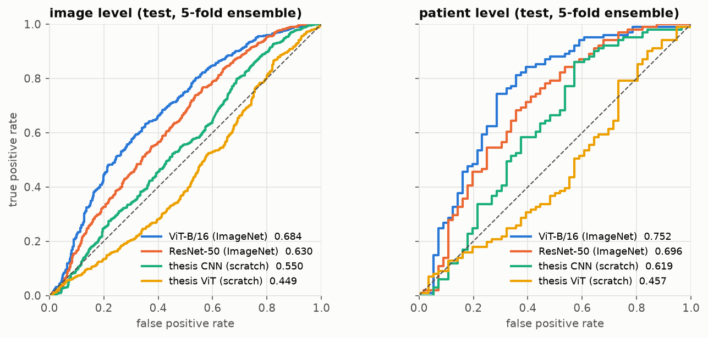
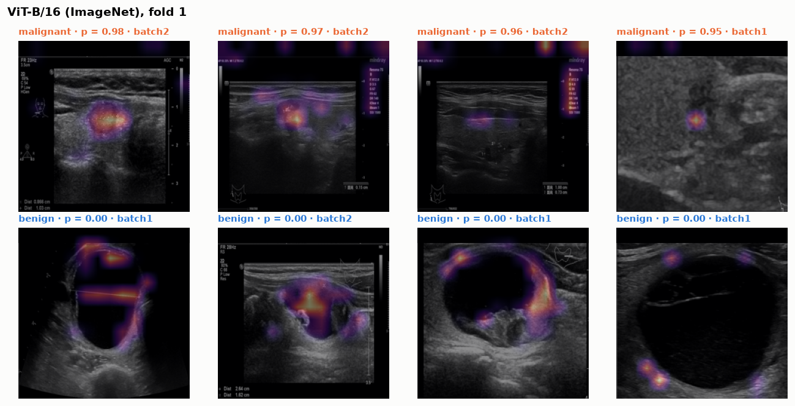
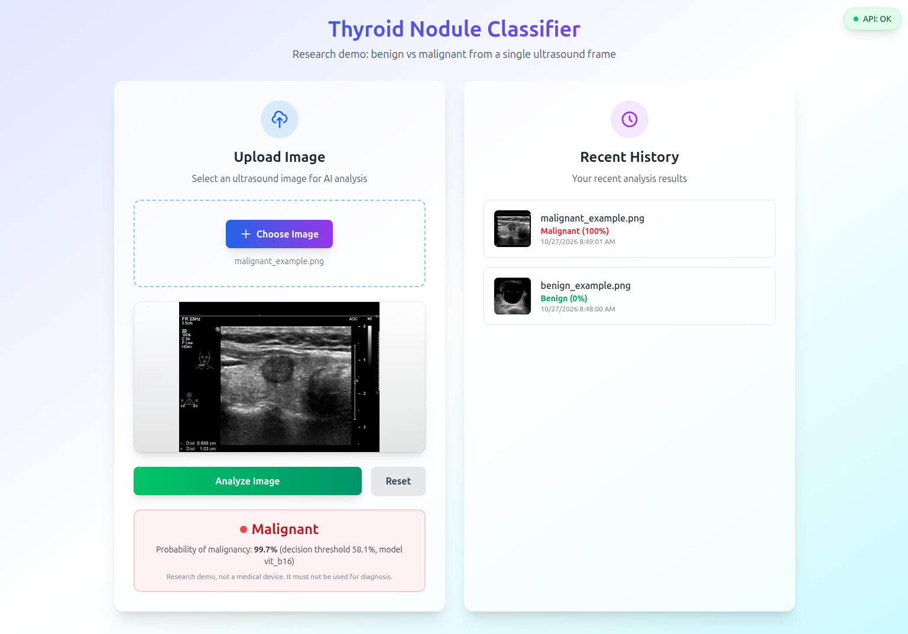

# Thyroid Nodule Classification from Ultrasound


Benign vs malignant classification of thyroid nodules from ultrasound frames, comparing Vision
Transformers and CNNs with **patient-level** evaluation on histopathology-labelled data, plus a
small web app that serves the best model.

This started as my engineering thesis. Revisiting it showed the original evaluation could not be
trusted: images of the same patient appeared in both training and validation, one dataset's test
folder was a copy of its training folder, and the CNN metrics were computed on misaligned labels.
This repository is the thesis redone properly. The original notebooks are kept unchanged in
[`thesis/`](thesis/), with a list of what was wrong in them.

**Result:** an ImageNet-pretrained ViT-B/16 reaches **0.75 AUROC per patient** (0.68 per frame) on
157 held-out patients. The thesis architectures trained from scratch stay at chance level, so the
thesis' original result does not hold up under patient-level evaluation.



## Results

Held-out test set, 157 patients / 1473 frames. *Ensemble* averages the scores of the 5 fold
models; *fold mean* is mean ± std of the 5 models evaluated separately. Patient level uses the
mean score over a patient's frames.

| Model | AUROC patient (ensemble) | AUROC patient (fold mean) | AUROC frame (ensemble) | AUROC frame (fold mean) |
| --- | --: | --: | --: | --: |
| **`vit_b16`** | **0.752** | **0.724 ± 0.027** | **0.684** | **0.652 ± 0.026** |
| `resnet50` | 0.696 | 0.678 ± 0.018 | 0.630 | 0.612 ± 0.011 |
| `cnn_thesis` | 0.619 | 0.578 ± 0.061 | 0.550 | 0.533 ± 0.029 |
| `vit_thesis` | 0.457 | 0.461 ± 0.015 | 0.449 | 0.456 ± 0.005 |

AUPRC, sensitivity, specificity and balanced accuracy at the validation-chosen threshold are in
[`results/summary.md`](results/summary.md). Analysis in
[`notebooks/02_results.ipynb`](notebooks/02_results.ipynb):

- **Pretraining is what makes this work.** About 6000 training frames are not enough to train
  the thesis ViT or CNN from random weights.
- **Fast overfitting.** The pretrained models peak at validation within 2–11 epochs.
- **Per batch,** ViT-B/16 reaches 0.79 per patient on batch 1 (120 test patients) and 0.62 on
  batch 2. With only 37 test patients, the batch 2 number is uncertain by about ±0.1.

### Does the model look at the nodule?

Ultrasound frames carry burned-in scanner overlays that could serve as shortcuts. Two checks on
the best ViT-B/16 fold model:

| Frames scored with | AUROC (400 test frames) |
| --- | --: |
| full frame | 0.657 |
| header (date, exam number) blacked out | 0.650 |
| only the central 60% × 60% box | 0.648 |
| central box blacked out | 0.592 |

The header is not used, and almost all of the signal sits in the central region where the nodule
is. Grad-CAM agrees: malignant predictions focus on hypoechoic spots inside the nodule, and benign
ones on the walls of cystic nodules. Reliance on calipers or Doppler boxes inside the
central region is not ruled out.



*The top 9% of each frame (date and exam number) is masked in the figure only.*

## Data

[Figshare 26067475](https://doi.org/10.6084/m9.figshare.26067475) (CC BY 4.0), with two batches
of ultrasound frames, each patient labelled by **histopathology**. After cleaning there are
**7813 frames from 785 patients**; 64% of the patients are malignant.

| | Patients | Frames |
| --- | --: | --: |
| Benign | 282 | 2608 |
| Malignant | 503 | 5205 |

Cleaning (details and counts in [`notebooks/01_data.ipynb`](notebooks/01_data.ipynb)):

- only the frames listed in the batch CSVs are kept, which drops 773 scanned pathology reports;
- patients are re-identified as `b1-XXXX` / `b2-XXXX` and no names are written anywhere;
- near-duplicates are removed (dHash); the same image under two patients is dropped entirely;
- AUITD, the second dataset used in the thesis, is excluded. Its labels are TI-RADS categories
  rather than pathology, its `test/` folder duplicates `train/`, and it has no patient IDs.

## Method

| Model | Init | Input |
| --- | --- | --- |
| `vit_thesis` | from scratch (the thesis ViT, unchanged) | 256 px |
| `cnn_thesis` | from scratch (the thesis CNN, ported from Keras) | 256 px |
| `resnet50` | ImageNet | 224 px |
| `vit_b16` | ImageNet-21k → 1k | 224 px |

- **Splits:** 157 test patients (20%) are held out. The remaining 628 patients form 5 folds
  (`StratifiedGroupKFold` on source × label), so no patient is ever in two splits. The split is
  committed in [`data/splits/`](data/splits/).
- **Training:** each model is trained 5 times, once per fold. Fold *k* is validation, used for
  early stopping (image AUROC) and for the decision threshold (Youden's J). The other folds are
  training data. AdamW, cosine schedule with warmup, class-weighted loss, light augmentation
  (crop, flip, ±10° rotation, brightness/contrast), bf16.
- **Evaluation:** every fold model is scored on the untouched test set. The report gives
  mean ± std over the 5 models and a 5-model ensemble, at image level and at patient level
  (mean score over a patient's frames). Metrics: AUROC, AUPRC, sensitivity, specificity, balanced
  accuracy, and majority-class accuracy as a reference.

## Reproduce

Requires [uv](https://docs.astral.sh/uv/) and an NVIDIA GPU for training.

```bash
uv sync
./scripts/download_data.sh                 # 1.9 GB from Figshare, MD5-checked
uv run python -m thyroid.data.prepare      # -> data/processed/, data/splits/manifest.csv
uv run python -m thyroid.data.splits       # -> data/splits/patients.csv (already committed)

./scripts/train_all.sh                     # 4 models x 5 folds, resumable -> runs/, results/
uv run python -m thyroid.export --model vit_b16   # -> models/vit_b16.pt for the app
```

Single runs: `uv run python -m thyroid.train --model resnet50 --fold 0`. Pipeline check on CPU in
seconds: add `--smoke`.

## Web app

FastAPI backend and React frontend. The backend loads an exported model and returns the
malignancy probability together with the validation-chosen threshold. The served model is the
single ViT-B/16 fold with the best validation AUROC (fold 1: 0.679 validation, 0.651 test per
frame). The ensemble numbers above need all five models.

```bash
cd app
MODEL=vit_b16 docker compose up --build     # UI on http://localhost:3000, API on :8000
```



The app is a research demo. It is not a medical device and must not be used for diagnosis.

## Project structure

The repository follows the pipeline, from left to right:

```
download_data.sh -> prepare -> splits -> train (4 models x 5 folds) -> summarize -> export -> app
```

```
src/thyroid/                 all Python code, one module per pipeline step
  data/prepare.py            raw archives -> anonymised, deduplicated frames + manifest
  data/splits.py             patient-level test set and CV folds
  data/dataset.py            PyTorch dataset and transforms
  models/                    registry; vit_thesis.py and cnn_thesis.py are the thesis architectures
  train.py                   one model x one fold: training, early stopping, test predictions
  metrics.py                 image- and patient-level metrics, thresholds
  summarize.py               fold aggregation and ensemble -> results/
  export.py                  trained fold -> self-contained file for serving
  explain.py                 Grad-CAM and scoring helpers for the notebooks
scripts/                     data download and the full training loop
notebooks/                   01_data (dataset and cleaning), 02_results (metrics, ROC, Grad-CAM, occlusion)
data/splits/                 manifest and patient split, committed (no personal data)
results/                     summary tables and README figures
app/                         FastAPI backend, React frontend, docker-compose
thesis/                      original thesis notebooks (archive) and their known issues

Generated locally, not committed:
data/raw/, data/processed/   downloaded archives and cleaned frames
runs/<model>/fold<k>/        checkpoints, training history, predictions, metrics
models/                      exported model for the app
```

## Limitations

- The frames carry burned-in scanner UI, including calipers and colour-Doppler boxes that
  sonographers add to suspicious nodules. The occlusion test rules out the header strip but not
  overlays that sit on the nodule itself.
- AUROC 0.75 per patient is far from clinical use. Models are trained per frame with the
  patient's label; training on all frames of a patient jointly (multiple-instance learning) is
  the obvious next step.
- All data comes from one published dataset. There is no external test set from another hospital, so
  the numbers say nothing about generalisation to other scanners or populations.
- Labels are per patient; individual frames may not show the diagnosed nodule.

## License

[MIT](LICENSE)
